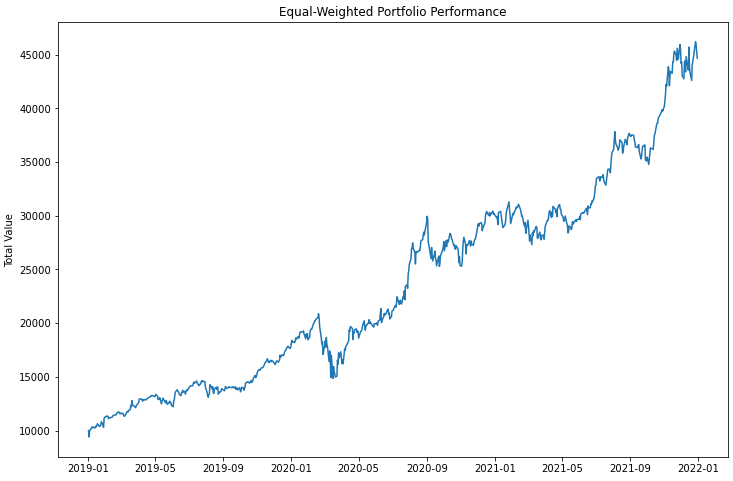
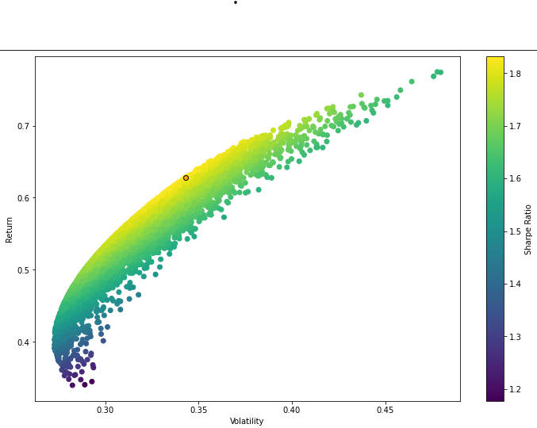

# Portfolio Optimization with Python

## Architecture

```
 data/AMD.csv  data/AAPL.csv  data/MSFT.csv  data/ORCL.csv
   (daily Adj Close, Jan 2019 – Dec 2021, one file per ticker)
            │
            ▼
 2.Portfolio_Optimization.ipynb
   ├── Part 1: Equal-weighted portfolio ($10,000, 25% each)
   │      └── value over time, cumulative return, daily return,
   │          volatility, Sharpe & annualized Sharpe ratio
   └── Part 2: Optimized portfolio
          ├── 10,000 random weight scenarios (Monte Carlo)
          ├── annualized return / volatility / Sharpe per scenario
          └── max-Sharpe portfolio + risk-vs-return scatter plot
```

## Business Overview

Investors need to decide how much of their capital to put into each asset, and splitting it
evenly is the simplest choice but rarely the best. This project compares a naive
equal-weighted portfolio against one whose weights are chosen to maximize risk-adjusted
return. It uses the Sharpe ratio to measure how much return each allocation earns per
unit of risk, and shows the whole set of possible allocations so the trade-off between
risk and reward is easy to see.

## Aim

Build two $10,000 portfolios of four tech stocks from daily price data: one with equal
weights, and one with the weights that give the highest Sharpe ratio out of 10,000
randomly generated allocations. Then compare their performance and visualize where the
optimal portfolio sits among all the scenarios.

## Dataset Description

Daily adjusted closing prices for four tickers: **AMD, AAPL, MSFT, ORCL**. The data covers
2 January 2019 to 30 December 2021 (756 trading days) and comes as one CSV per ticker,
provided with the case study.

Fields in each `data/<TICKER>.csv`:

- `Date`: trading day (used as the index)
- `Adj Close`: closing price adjusted for splits and dividends

## Approach

1. **Load**: read each ticker's CSV into a dictionary of DataFrames, indexed by date.
2. **Build the equal-weighted portfolio**: for each stock, compute Normalized Return
   (`Adj Close / first Adj Close`), Allocation (`× 0.25`) and Position Value (`× $10,000`),
   then combine the position values into one DataFrame with a `Total` column.
3. **Visualize performance**: line charts of the total portfolio value and of each stock's
   position value over time.
4. **Calculate metrics**: cumulative return, mean and standard deviation of daily returns,
   Sharpe ratio (risk-free rate assumed ≈ 0) and annualized Sharpe ratio (× √252). The
   equal-weighted portfolio returned **346.84%** over the period, with an annualized
   Sharpe ratio of **1.69**.
5. **Prepare scenarios**: build a table of adjusted closes (one column per ticker) and
   turn it into daily percent changes.
6. **Run 10,000 scenarios**: generate random weights that sum to 1. For each set, compute
   annualized return, annualized volatility (from the covariance matrix) and the Sharpe
   ratio, and store them in pre-allocated NumPy arrays.
7. **Find the optimal portfolio**: select the scenario with the highest Sharpe ratio
   (**1.83**). Its weights are roughly **AMD 29.8%, AAPL 55.9%, MSFT 13.3%, ORCL 1.1%**.
8. **Visualize**: scatter plot of volatility vs. return for all scenarios, coloured by
   Sharpe ratio, with the optimal portfolio highlighted.

## Results



The equal-weighted portfolio grew from $10,000 to about $44,700 between January 2019 and December 2021.



Volatility vs. return for all 10,000 weightings, coloured by Sharpe ratio. The black-outlined point is the optimal (max-Sharpe) portfolio.

## Tech Stack

**Language:** Python

**Libraries:** pandas, NumPy, Matplotlib

**Environment:** Jupyter Notebook

## Key Learning Takeaways

- Building a portfolio from imported price data by normalizing returns and applying weights
- Visualizing portfolio and individual stock performance over time
- Calculating daily returns, volatility and the (annualized) Sharpe ratio as a risk-adjusted performance measure
- Using Monte Carlo simulation to explore portfolio weightings and pick the one with the best risk-adjusted return
